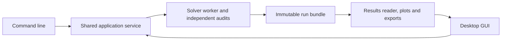

# Product, GUI and release plan

User-requested direction, 2026-10-30: finish a usable steady solver and GUI,
provide an everyday-use explanation, merge the completed release into `main`,
then develop transient behavior, TEHL and point/line contact selection.
This is a proposed delivery plan, not a list of implemented features.

The existing numerical evidence and detailed development history remain in
[ROADMAP.md](ROADMAP.md). Today's working CLI is described in
[USER_GUIDE.md](USER_GUIDE.md). Current package version 0.1.0 is a research
prototype; the milestones below define a future v1, not an existing release.

## Agreed order and v1 scope

1. Finish and independently validate the steady isothermal point-contact core.
2. Stabilize the application API, case format and result/report workflow.
3. Build and verify the GUI using that same core.
4. Finish installation, examples and the version-specific user walkthrough.
5. Pass the release gate, then merge the release from `develop` into `main`.
6. Add post-release model extensions on separate tested feature branches.

The v1 baseline is the smooth, fully flooded, steady isothermal circular
point-contact model over a **declared validated parameter range**, with
pressure-dependent fluid laws, mass-conserving cavitation, elasticity and load
control. Broader geometry or material coverage requires its own evidence.
Transient, thermal and line-contact modes are post-release extensions in this
plan. A GUI must not imply that those modes already work.

Milestones use completion gates rather than promised calendar dates. The
remaining numerical robustness/accuracy work determines when the core is
ready; a good-looking plot or a low residual cannot replace that gate.

## R1 — Complete the numerical core

A bounded nonlinear adapter, state/guide updates, active-front recovery and
rollback/load-step tests are now implemented experimentally; see
[LIMITED_NONLINEAR.md](LIMITED_NONLINEAR.md). Loaded MC robustness and physical
mesh convergence remain open. A [guarded secant endpoint](LIMITED_ENDPOINT.md)
now closes the 50 N MC equations on 33x33, 65x65 and 129x129; these are
finite-grid numerical results with unresolved spatial accuracy.
Preserve the arithmetic and donor references.
The final default scheme is chosen from validated evidence; the isolated candidate is not automatically the winner.

Deliverables and exit criteria:

- Complete matrix-free products, sparse preconditioning, reconstructed
  bordered corrections and independently measured Krylov residuals.
- Strict film feasibility, original pressure/content bounds, actual
  directional-derivative Armijo tests, recovery and retained failed diagnostics.
- Independently recomputed final Reynolds/mass, force, film coupling,
  complementarity and boundary checks for accepted roots.
- Physical benchmarks beginning with the registered 50 N and 200 N cases,
  then a documented operating/material envelope and its limits.
- Controlled mesh/domain/exit/side-lobe convergence, tracking both film values
  and pressure/minimum locations. Set numerical accuracy targets before the
  final validation campaign; do not adjust gates to match a correlation.
- HD comparisons with explicit modulus/fluid conventions, plus independent
  reference evidence appropriate to the claimed physical model. HD is a
  benchmark, not an exact solution or a universal error bound.

Exit R1 only when the selected baseline has reproducible evidence for its
claimed range. Archive experimental alternatives with their mathematical or
unvalidated status intact. Optional GPU components retain CPU parity gates;
a physical GPU solver is included in a supported release only after its own
coupled validation. CPU correctness remains the reference.

## R2 — Application and data contract

Create one application layer used by the CLI, GUI and automated batches.
The GUI must not contain its own Reynolds, elasticity, cavitation or load
implementation. Preserve SI at the solver boundary and version every new
case/result schema. Migrate existing flat JSON inputs explicitly and retain
regression fixtures; planned schema fields must not be added to today's files
until the parser supports them.

Planned contract:

- Validated physical case, geometry/model identity, fluid properties,
  boundary conditions and mesh/domain controls.
- Separate operating inputs from advanced numerical options, with validated
  defaults and explicit resource limits.
- Run service with progress events, bounded execution, safe cancellation and
  preserved diagnostics/checkpoints. Numerical iteration is distinct from
  physical time; a partial/cancelled run is never marked converged.
- Immutable run directory with resolved SI inputs, units/scales, solver/model
  version, backend, tolerances, source/runtime provenance, checksums, raw data,
  audits and plots.
- Reusable results reader and export service for raw arrays, labeled CSV,
  figures and a portable report. Saved cases/results reopen on another
  installation without relying on one workstation's absolute paths.

The packaged application should keep user projects/cases/runs separate from
its installation directory. Shipped templates open as copies in a user-owned
workspace; each run gets a new result directory.



Proposed run states are queued, running, numerically accepted, rejected,
cancelled and interrupted. Independently show whether a case lies within a
validated model envelope and whether spatial/domain accuracy was assessed.
Those labels are separate from the solver's convergence status.

## R3 — GUI

Working assumption: a local desktop application for this workstation, with
Linux as the first target. The GUI framework, additional target systems and
installer format will be selected through a small packaging/UI prototype;
no toolkit, platform support or installer is claimed implemented here.

The ordinary workflow should require no terminal and no Python editing:

| View | User action and information |
| --- | --- |
| Project/cases | Open a template or saved case, duplicate and name a case |
| Physical inputs | Geometry, load, material/fluid and operating conditions with visible units |
| Domain/mesh | See dimensions, entrainment direction, grid size and resource limits before running |
| Run | Start/cancel, see progress and a clear reason for rejection or interruption |
| Results | Pressure, film, liquid content, cross sections, minimum location and convergence diagnostics |
| Compare/export | Compare compatible runs/meshes and export figures, raw tables and the reproducible report |

Unit widgets may display engineering units, but convert once to canonical SI
and retain the original display selection. Identify E_contact/E_prime and
mean entrainment explicitly. Show labeled plot display limits and export
uncapped raw fields. Present the actual film separately from the signed
load-control offset. HD overlays apply only where the chosen correlation is
appropriate. Do not show solver iteration as physical transient time.

A simple proposed layout:

```text
Cases / runs | Physical inputs and domain/mesh | Pressure / film / profiles
             | Run / cancel / progress        | Status / audits / comparison
```

Run the solver in an isolated worker so the interface remains responsive.
Route worker events through the application service; neither rendering nor
cancellation may silently change solver thresholds or discard failed states.
Keep advanced numerical controls out of the ordinary input path unless the
user chooses an expert view. Unimplemented model combinations are clearly
unavailable and never fall back to another physical model.

GUI acceptance requires CLI/GUI parity for the same resolved cases, unit
conversion tests, useful invalid-input messages, responsive run/cancel,
correct partial-run status, reopening saved results, repeatable exports and
installation checks on every declared supported platform.

## R4 — Everyday-use documentation and packaging

The current [user guide](USER_GUIDE.md) already explains where JSON inputs go
and how to read reports/plots. Refresh it against the final v1 interfaces and
add:

- Installation/launch instructions for each supported platform.
- A worked point-contact example with the actual shipped input, expected
  result ranges, interpretation and grid/domain assessment.
- A GUI walkthrough with screenshots: create/open case, edit units, run,
  compare, export, reopen and diagnose a rejected calculation.
- A concise parameter reference and a clear statement of validated model
  range, unsupported physics and practical resource limits.
- CLI/batch instructions and portable sample project/result bundles.

Exit R4 when the documented examples run on a clean supported installation
and an everyday user can reproduce the workflow without editing solver code.
Do not require MATLAB, a development IDE or a GPU for the CPU baseline.

## R5 — Conditional merge into main and v1 release

`develop` remains the integration branch while the work above is unfinished.
The user's requested `main` merge is scheduled after completing the code,
GUI and release checks, before post-release feature development. Today's
research state has not met that release gate.

Release gate:

- R1 numerical/physical evidence and a frozen, explicitly scoped supported
  model/range; no unfinished physical-validation claim marked complete.
- R2–R4 application, GUI, installation, documentation and example checks.
- Clean full CPU CI and Ruff; optional GPU support is either verified within
  its stated scope or explicitly outside the physical baseline.
- Regression checks for failures, cancellation, units, old-case migration,
  result reproducibility and CLI/GUI parity.
- Reviewed final diff, accurate release notes, known limitations, versioned
  case/result formats and reproducible validation artifacts.

When those gates pass, prepare a release branch/PR from the verified
`develop` revision into `main`, run release CI, review and merge without
rewriting published history, then tag the tested release and publish its
installation/user documentation. Keep `main` as the stable release history.
Future development continues through feature branches and `develop`; later
releases follow the same gated path into `main`.

## After v1/main — Model extensions

Introduce extension interfaces before adding new equations, but implement
and enable each model only after its independent benchmarks pass. Keep the
released steady point-contact cases as regression references throughout.

### F1 — Steady isothermal line contact and geometry selection

Line contact is proposed first to establish an additional steady reference
before adding time and thermal coupling.

Add a separate line-contact geometry, elastic operator, Reynolds/load
normalization and Hertz line-contact benchmark. Line load is force per
length, N/m, whereas point-contact load is total force, N. If the interface
accepts total force for a line model, require an explicit modeled width and
record the conversion assumptions. Never reinterpret 200 N as 200 N/m.

Implement and validate the line model first, then enable the GUI/CLI
point/line selector. Setting `ny=1` on the present point solver is not a line
implementation. Line results use the appropriate x profiles; do not fabricate
a 2-D point-contact plot. Changing model creates a distinct case and cannot
silently reuse an incompatible accepted seed.

### F2 — Transient isothermal behavior

Add physical time, the conservative mass-storage/squeeze contribution,
initial conditions, time-varying load/surface speeds and bounded time stepping.
Track accepted time states, mass inventory versus boundary flow, temporal
error independently from spatial error, and restart provenance. A known
steady state should persist under constant inputs, and appropriate limiting
cases/manufactured transients must pass before application benchmarks.

Expose actual time in seconds and accepted-time animations/history plots.
Keep nonlinear/Krylov iteration histories separate. Failed/rejected time
steps must not appear as accepted physical states. Validate point and line
variants separately; support in one does not automatically validate the other.

### F3 — Steady thermal EHL (TEHL)

Specify the thermal model and solid/fluid heat-transfer assumptions before
implementation. Add energy balance, thermal boundary conditions, temperature-
dependent fluid properties, appropriate solid thermal properties, sliding/
heat-generation inputs and consistent coupling to pressure/film/load.
Mean entrainment alone does not specify both surface speeds for thermal
sliding calculations. Record all thermal property units/ranges explicitly;
canonical temperatures are SI kelvin even if the GUI offers Celsius.

Benchmark energy conservation, conduction/advection/source terms, an
isothermal limiting case and independent thermal EHL references. Select the
thermal dimensionality and heat-partition/conduction model with documented
accuracy/cost evidence. A thermal checkbox is enabled only for validated
implementations; isothermal HD agreement is not TEHL validation. Shear
thinning or other rheology is a separate explicit model extension.

### F4 — Transient TEHL and combined model support

Combine independently verified transient and thermal components. Test
coupled mass/energy balances, time/space convergence, thermal initial and
boundary conditions, restart fidelity and point/line-specific benchmarks.
Document the supported combinations; do not infer combined validation from
separate component tests.

The intended long-term selection matrix is:

| Physical mode | Point contact | Line contact |
| --- | --- | --- |
| Steady isothermal | v1 baseline | F1 |
| Transient isothermal | F2 | F2 after line validation |
| Steady TEHL | F3 | F3 after line validation |
| Transient TEHL | F4 | F4 after combined line validation |

In the future interface, contact geometry, steady/transient operation and
isothermal/thermal physics are separate choices backed by explicit capability
checks. Unsupported combinations stay disabled. Each extension gets its own
feature branch, schema/docs/tests and benchmark evidence before integration
into `develop` and a subsequent gated `main` release.
